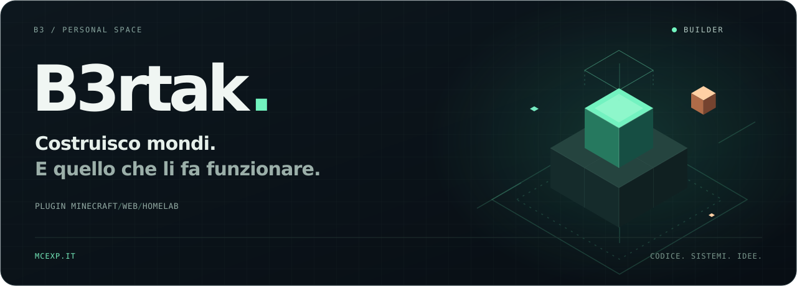
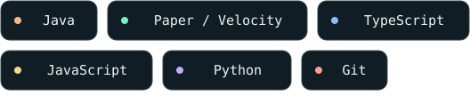
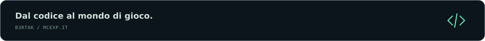

  

  <a href="https://mcexp.it"><strong>McExp.it ↗</strong></a>
  &nbsp; · &nbsp;
  <a href="https://github.com/minecraftexperienceserv"><strong>McExp su GitHub ↗</strong></a>

 

### Ciao, sono B3rtak.

Mi occupo di **McExp.it**, tra sviluppo Minecraft, strumenti web e gestione dei server. Nel mio **homelab** sperimento con servizi e automazioni: mi piace capire come funzionano le cose e farle lavorare insieme.

 

### Tre modi di costruire

| | Cosa faccio |
| :--- | :--- |
| **01 / MINECRAFT** | Plugin, meccaniche di gioco e interfacce per l'ecosistema **McExp**. |
| **02 / WEB & TOOLS** | Siti, pannelli e piccoli strumenti per semplificare il lavoro quotidiano. |
| **03 / HOMELAB** | Servizi personali, automazioni e un laboratorio per provare nuove idee. |

 

### Nel mio laboratorio

  

 

  

